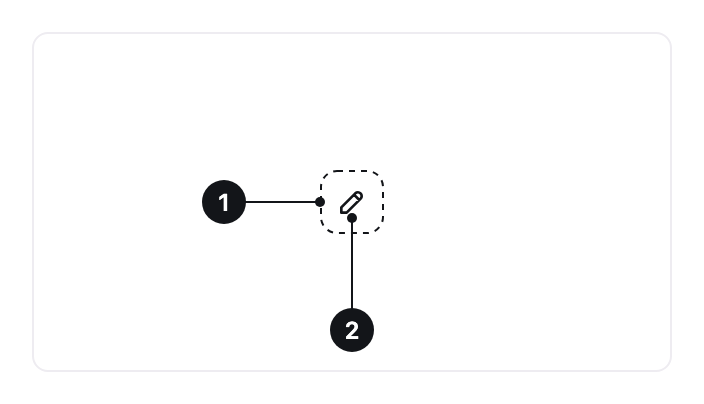

<ComponentEmbed component="IconButton" variant="md" />

## Best practices

<DosDonts variant="do" title="Universally recognizable actions">
  Close, edit, delete, copy, more options, search, back.
</DosDonts>

<DosDonts variant="do" title="Little space">
  Toolbars, table rows, card headers and media controls.
</DosDonts>

<DosDonts variant="dont" title="Actions the icon cannot explain on its own">
  If the person has to guess what the icon does, use a [Button](../button/index.mdx) with text.
</DosDonts>

<DosDonts variant="dont" title="The main action of the screen">
  Important actions deserve a visible label.
</DosDonts>

<DosDonts variant="dont" title="Closing a modal, drawer or alert">
  The [Close Button](../close-button/index.mdx) already comes with the icon and the accessible name.
</DosDonts>

## Anatomy

1. **Container**: sets the touch target and the visual state. It is transparent at rest and gains color in interaction states.
2. **Icon**: a 24px SVG that inherits the text color.

## Sizes

| Size | Measure | Usage |
| --- | --- | --- |
| `lg` | 40px | Roomy areas, headers, main controls. |
| `md` (default) | 32px | Toolbars, tables and compact layouts. |

## States

Default, hover, focus, pressed and disabled, with the same behavior as the [Button](../button/index.mdx). The disabled state indicates the action is not available right now.

### Toggle

An Icon Button can turn an option on and off, like a filter or a formatting option. When **on**, it gets the neutral container background. Hover, focus and disabled keep working on top of that state.

<ComponentEmbed component="IconButton" variant="pressed" />

## Related

- [Button](../button/index.mdx): action with a label.
- [Close Button](../close-button/index.mdx): close and dismiss.
- [Tooltip](../../content/tooltip/index.mdx): explains the icon on hover or focus.
