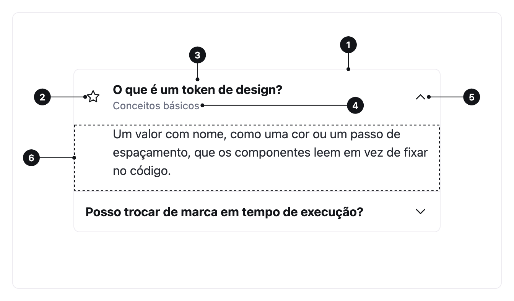

<ComponentEmbed component="Accordion" variant="default" />

## Boas práticas

<DosDonts variant="do" title="Perguntas frequentes">
  Respostas que a pessoa lê uma de cada vez.
</DosDonts>

<DosDonts variant="do" title="Blocos de configuração">
  Seções longas agrupadas por assunto.
</DosDonts>

<DosDonts variant="do" title="Detalhes, termos e políticas">
  Conteúdo longo que não precisa ficar todo aberto.
</DosDonts>

<DosDonts variant="dont" title="Informação essencial">
  Se quase todo mundo precisa ler, deixe visível.
</DosDonts>

<DosDonts variant="dont" title="Navegar entre áreas diferentes">
  Use [Tabs](../../navigation/tabs/index.mdx).
</DosDonts>

<DosDonts variant="dont" title="Conteúdo curto">
  Se cabe na tela, não precisa esconder.
</DosDonts>

<DosDonts variant="dont" title="Passos de um fluxo">
  Use um indicador de passos.
</DosDonts>

## Anatomia

1. **Cabeçalho**: toda a faixa é clicável e funciona como um botão.
2. **Ícone** (opcional): decorativo, à esquerda do título.
3. **Título**: nomeia a seção.
4. **Subtítulo** (opcional): texto de apoio abaixo do título.
5. **Seta**: gira para indicar aberto ou fechado.
6. **Painel**: o conteúdo revelado.

## Variantes

| Variante | Descrição | Quando usar |
| --- | --- | --- |
| **Default** | Itens separados por divisores. | Páginas de conteúdo, FAQs. |
| **Bordered** | A lista inteira dentro de uma borda arredondada. | Contextos que pedem moldura, como cards. |
| **Highlighted** | Contorna o item aberto. | Quando é importante localizar o item ativo. |

<ComponentEmbed component="Accordion" variant="bordered" />

<ComponentEmbed component="Accordion" variant="highlighted" />

## Comportamento

- Por padrão, **um item aberto por vez**: abrir um fecha o anterior.
- Com `multiple`, a pessoa pode abrir vários ao mesmo tempo.
- Itens desabilitados não alternam e saem da ordem de foco.

<ComponentEmbed component="Accordion" variant="multiple" />

## Relacionados

- [Tabs](../../navigation/tabs/index.mdx): alternar entre visões.
- [Card](../card/index.mdx): agrupar conteúdo.
