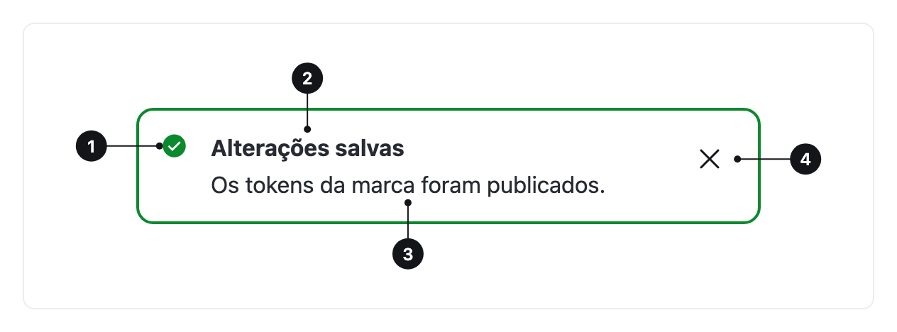

<ComponentEmbed component="Alert" variant="success" />

## Boas práticas

<DosDonts variant="do" title="Sucesso depois de salvar">
  Uma confirmação que fica na página, junto ao contexto.
</DosDonts>

<DosDonts variant="do" title="Erro em um formulário">
  Um resumo do que precisa ser corrigido.
</DosDonts>

<DosDonts variant="do" title="Avisos e informações importantes">
  Uma limitação ou uma informação relacionada ao contexto.
</DosDonts>

<DosDonts variant="dont" title="Feedback passageiro de uma ação">
  Para retorno que some sozinho, use o [Toast](../toast/index.mdx).
</DosDonts>

<DosDonts variant="dont" title="Decisões que bloqueiam a tarefa">
  Use um [Modal](../modal/index.mdx).
</DosDonts>

<DosDonts variant="dont" title="Texto de apoio em um campo">
  Use o hint do campo.
</DosDonts>

<DosDonts variant="dont" title="Mensagens decorativas ou promocionais">
  O Alert é para informação relevante.
</DosDonts>

## Anatomia

1. **Ícone**: reforça a variante. É decorativo.
2. **Título**: resume a mensagem em poucas palavras.
3. **Conteúdo**: explica e orienta o que fazer.
4. **Botão de fechar** (opcional): dispensa o alerta.

## Variantes

| Variante | Significado | Exemplo |
| --- | --- | --- |
| **Info** | Informação neutra e útil. | "Novos recursos disponíveis." |
| **Success** | Algo deu certo. | "Alterações salvas." |
| **Caution** | Atenção: pode haver um problema. | "Seu plano termina em 3 dias." |
| **Danger** | Algo deu errado ou precisa de ação urgente. | "Não foi possível processar o pagamento." |

<ComponentEmbed component="Alert" variant="danger" />

## Dispensável

Com `dismissible`, o Alert ganha um botão de fechar. Use quando a mensagem pode ser ignorada com segurança. Mensagens de erro que bloqueiam a tarefa não devem poder ser fechadas até serem resolvidas.

## Relacionados

- [Toast](../toast/index.mdx): feedback temporário.
- [Modal](../modal/index.mdx): decisões que exigem atenção total.
- [Close Button](../../actionable/close-button/index.mdx): o botão de fechar.
