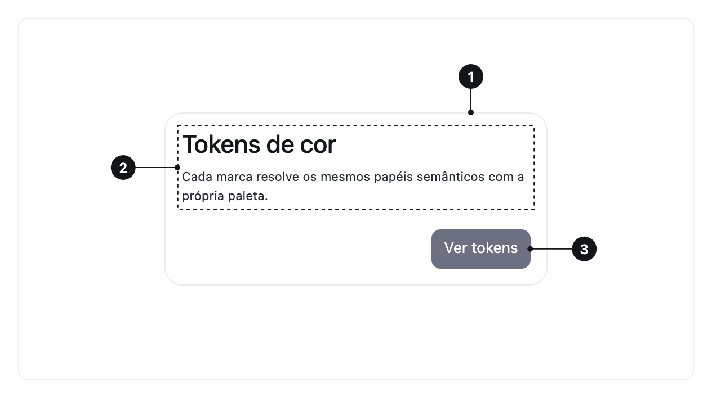

<ComponentEmbed component="Card" variant="default" />

## Best practices

<DosDonts variant="do" title="Content about an item">
  A product, a project or a summary.
</DosDonts>

<DosDonts variant="do" title="Setting a block apart from the rest">
  A group of settings visually highlighted on the page.
</DosDonts>

<DosDonts variant="dont" title="Running page content">
  The main content goes directly on the page.
</DosDonts>

<DosDonts variant="dont" title="Data in comparable columns">
  Use the [Table](../table/index.mdx).
</DosDonts>

<DosDonts variant="dont" title="Status messages">
  Use the [Alert](../alert/index.mdx).
</DosDonts>

<DosDonts variant="dont" title="Cards inside cards">
  Nesting surfaces creates visual noise.
</DosDonts>

## Anatomy

1. **Surface**: the background with a border and subtle elevation.
2. **Content**: title, text, media and whatever else makes sense.
3. **Actions** (optional): buttons or links, aligned to the end.

## Behavior

The Card is a flexible container. The content is free, so the Card **does not impose** a structure. Inner spacing and radius follow the system tokens.

## Clickable cards

When the whole Card leads somewhere, **a single link** inside it should be the main target. Avoid several clickable elements competing inside the same Card.

## Related

- [Table](../table/index.mdx): comparable data.
- [Alert](../alert/index.mdx): messages.
- [Stack](../../layout/stack/index.mdx) and [Grid](../../layout/grid/index.mdx): arrange several cards.
