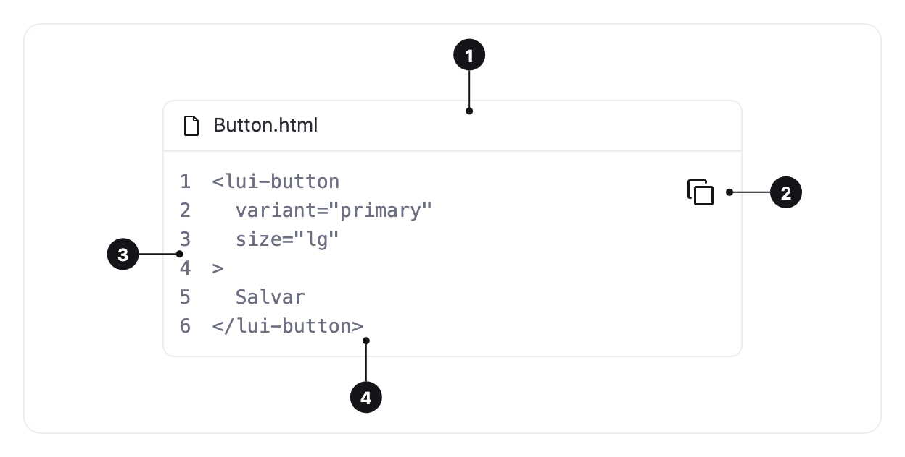

<ComponentEmbed component="CodeBlock" variant="default" />

## Best practices

<DosDonts variant="do" title="Code people read or copy">
  Install commands, usage examples and configuration files in documentation pages.
</DosDonts>

<DosDonts variant="do" title="A label when the context is not obvious">
  The file name in the `default` variant, the language or the shell in `snippet`.
</DosDonts>

<DosDonts variant="dont" title="A term in the middle of a sentence">
  For an inline excerpt, use `<code>` directly in the text. Code Block is a block.
</DosDonts>

<DosDonts variant="dont" title="Keyboard shortcuts">
  To show a key combination, use [Shortcut](../../typography/shortcut/index.mdx).
</DosDonts>

## Anatomy

1. **Header**: the file icon and the label. Only appears with `label`.
2. **Copy button**: copies the code to the clipboard, with a tip that confirms it.
3. **Line numbers**: optional, aligned to the right.
4. **Code**: the excerpt, in the code font of the brand.

## Variants

| Variant | Description | When to use |
| --- | --- | --- |
| **Default** | Header with a file icon and the label, separated from the code by a divider. | Files and longer examples. |
| **Snippet** | A short monospaced label right above the code, without divider or icon. | Terminal commands and one-liners. |

Without `label`, the header disappears in both variants.

<ComponentEmbed component="CodeBlock" variant="snippet" />

## Line numbers

Turn them on when the surrounding text mentions specific lines. In single-line commands, they only take up space.

<ComponentEmbed component="CodeBlock" variant="line-numbers" />

## Long lines

Lines that do not fit scroll horizontally instead of wrapping, so the indentation of the code is kept. The line numbers stay fixed while the code scrolls.

<ComponentEmbed component="CodeBlock" variant="long-lines" />

## Syntax highlighting

Code Block colors the code when the page connects a highlighting library, such as highlight.js. The colors come from the Let's UI tokens and follow the light and dark themes. Without a library, the code appears in a single color. See the Code tab.

## Related

- [Shortcut](../../typography/shortcut/index.mdx): keyboard keys and combinations.
- [Body](../../typography/body/index.mdx): the text around the code.
