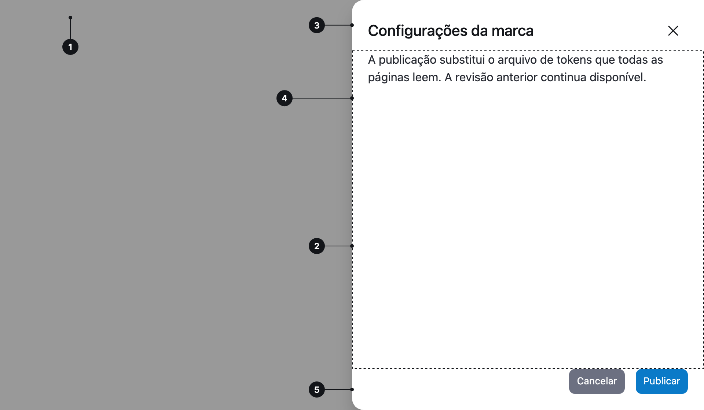

<ComponentEmbed component="Drawer" variant="closed" />

## Boas práticas

<DosDonts variant="do" title="Detalhes sem sair da página">
  Ver os detalhes de um item da tabela sem perder a lista de vista.
</DosDonts>

<DosDonts variant="do" title="Editar um registro">
  Formulários que precisam de mais espaço do que um [Modal](../modal/index.mdx).
</DosDonts>

<DosDonts variant="do" title="Filtros e configurações">
  Ajustes que a pessoa aplica sem perder o contexto da página.
</DosDonts>

<DosDonts variant="dont" title="Confirmações curtas">
  Use um [Modal](../modal/index.mdx).
</DosDonts>

<DosDonts variant="dont" title="Mensagens e avisos">
  Use [Alert](../alert/index.mdx) ou [Toast](../toast/index.mdx).
</DosDonts>

<DosDonts variant="dont" title="Conteúdo que merece uma página">
  Fluxos longos devem ter a própria tela.
</DosDonts>

<DosDonts variant="dont" title="Navegação principal">
  Use um menu ou [Sidebar](../../layout/sidebar/index.mdx).
</DosDonts>

## Anatomia

1. **Backdrop**: escurece a página atrás do painel.
2. **Painel**: a superfície que desliza pela direita.
3. **Cabeçalho**: título e botão de fechar.
4. **Corpo**: o conteúdo principal, que rola se for longo.
5. **Rodapé** (opcional): botões de ação, fixos na base.

## Tamanhos

| Tamanho | Quando usar |
| --- | --- |
| `sm` | Painéis simples, poucos campos. |
| `md` (padrão) | A maioria dos casos. |
| `lg` | Conteúdo com muita informação. |

## Comportamento

- Abre deslizando pela **direita**, com um backdrop sobre a página.
- O foco entra no painel, e a página atrás fica inacessível enquanto ele está aberto.
- Fecha com o botão de fechar, com "Cancelar", com `Esc` e, se habilitado, clicando no backdrop.
- Ao fechar, o foco volta para quem o abriu.

## Sem ações

Se o Drawer for só informativo, ou se as ações já fazem parte do conteúdo, omita o rodapé.

<ComponentEmbed component="Drawer" variant="open" />

## Relacionados

- [Modal](../modal/index.mdx): decisões curtas e foco total.
- [Sidebar](../../layout/sidebar/index.mdx): barra lateral fixa de layout.
- [Close Button](../../actionable/close-button/index.mdx).
