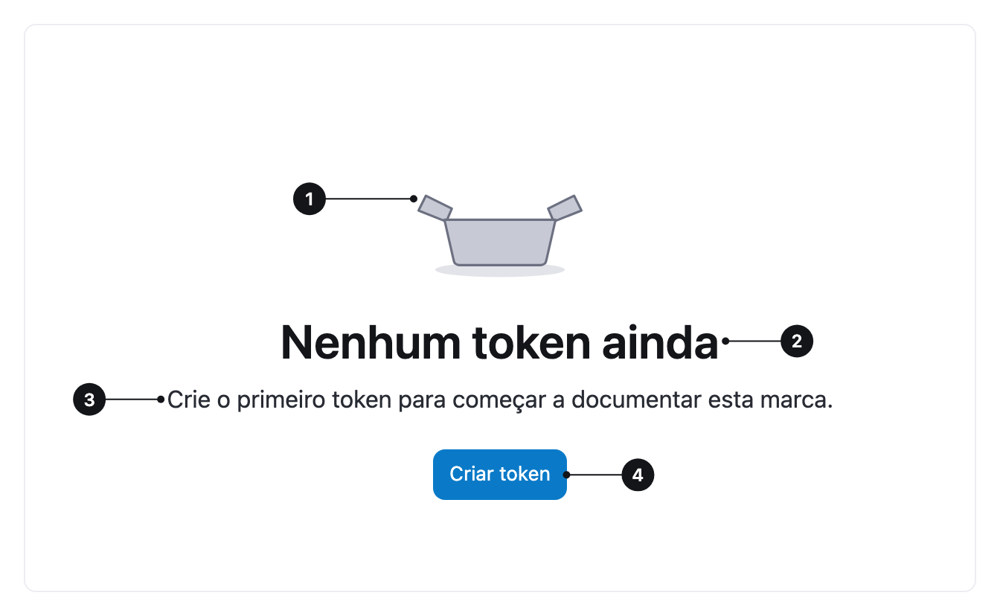

<ComponentEmbed component="EmptyState" variant="center" />

## Boas práticas

<DosDonts variant="do" title="Primeiro uso">
  A pessoa usa uma funcionalidade pela primeira vez.
</DosDonts>

<DosDonts variant="do" title="Busca sem resultados">
  Uma busca ou filtro não retornou nada.
</DosDonts>

<DosDonts variant="do" title="Conteúdo removido">
  O conteúdo foi excluído ou arquivado.
</DosDonts>

<DosDonts variant="do" title="Fila zerada">
  Não há mais nada pendente.
</DosDonts>

<DosDonts variant="do" title="Acesso restrito">
  Os dados não podem ser exibidos por permissão ou configuração.
</DosDonts>

<DosDonts variant="dont" title="Carregamento">
  Use um indicador de carregamento ou skeleton.
</DosDonts>

<DosDonts variant="dont" title="Páginas de erro do servidor">
  Erros como 404 e 500 pedem uma página própria.
</DosDonts>

<DosDonts variant="dont" title="Como decoração">
  O Empty State precisa explicar e orientar.
</DosDonts>

<Callout variant="warning">
  O Empty State deve **substituir por inteiro** o componente vazio. Não deixe cabeçalho de tabela, rodapé ou paginação "fantasma" ao lado dele.
</Callout>

## Anatomia

1. **Capa** (opcional): imagem, ilustração ou ícone. É decorativa.
2. **Título**: diz o que está acontecendo.
3. **Descrição** (opcional): explica o motivo e orienta.
4. **Ação** (opcional): o próximo passo, em um único botão primário.

## Alinhamento

| Alinhamento | Quando usar |
| --- | --- |
| **Centro** (padrão) | Páginas inteiras e painéis grandes. |
| **Esquerda** | Conteúdo de leitura alinhado à esquerda, como o corpo de uma tabela. |

<ComponentEmbed component="EmptyState" variant="left" />

## Tom depende do conteúdo

Não há "tipos" visuais de Empty State. O que muda é o **texto** e a **composição**.

| Situação | Tom | Composição |
| --- | --- | --- |
| Primeiro uso | Neutro e positivo | Capa, título, descrição e ação de criar. |
| Sem resultados | Neutro | Título e descrição com sugestão de ajuste. |
| Tarefa concluída | Celebratório | Título, ação opcional. |
| Sem permissão | Neutro e sério | Título, descrição e "Solicitar acesso". |
| Erro do sistema | Sério, sem humor | Título, descrição e "Tentar de novo". |
| Configuração pendente | Instrutivo | Título, descrição e ação de configurar. |

## Relacionados

- [Table](../table/index.mdx): onde aparece com frequência.
- [Button](../../actionable/button/index.mdx): a ação.
- [Alert](../alert/index.mdx): mensagens de estado dentro de uma página com conteúdo.
