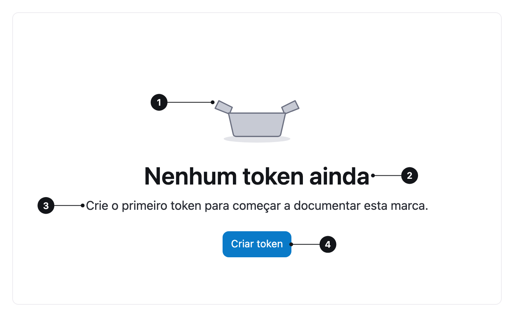

<ComponentEmbed component="EmptyState" variant="center" />

## Best practices

<DosDonts variant="do" title="First use">
  The person uses a feature for the first time.
</DosDonts>

<DosDonts variant="do" title="Search with no results">
  A search or filter returned nothing.
</DosDonts>

<DosDonts variant="do" title="Content removed">
  The content was deleted or archived.
</DosDonts>

<DosDonts variant="do" title="Empty queue">
  There is nothing left pending.
</DosDonts>

<DosDonts variant="do" title="Restricted access">
  The data cannot be shown because of permissions or configuration.
</DosDonts>

<DosDonts variant="dont" title="Loading">
  Use a loading indicator or skeleton.
</DosDonts>

<DosDonts variant="dont" title="Server error pages">
  Errors such as 404 and 500 call for a page of their own.
</DosDonts>

<DosDonts variant="dont" title="As decoration">
  The Empty State needs to explain and guide.
</DosDonts>

<Callout variant="warning">
  The Empty State must **fully replace** the empty component. Do not leave a "ghost" table header, footer or pagination next to it.
</Callout>

## Anatomy

1. **Cover** (optional): image, illustration or icon. It is decorative.
2. **Title**: says what is happening.
3. **Description** (optional): explains the reason and guides.
4. **Action** (optional): the next step, in a single primary button.

## Alignment

| Alignment | When to use |
| --- | --- |
| **Center** (default) | Full pages and large panels. |
| **Left** | Reading content aligned to the left, such as the body of a table. |

<ComponentEmbed component="EmptyState" variant="left" />

## Tone depends on the content

There are no visual "types" of Empty State. What changes is the **text** and the **composition**.

| Situation | Tone | Composition |
| --- | --- | --- |
| First use | Neutral and positive | Cover, title, description and create action. |
| No results | Neutral | Title and description with an adjustment hint. |
| Task completed | Celebratory | Title, optional action. |
| No permission | Neutral and serious | Title, description and "Request access". |
| System error | Serious, no humor | Title, description and "Try again". |
| Pending configuration | Instructive | Title, description and configure action. |

## Related

- [Table](../table/index.mdx): where it often appears.
- [Button](../../actionable/button/index.mdx): the action.
- [Alert](../alert/index.mdx): status messages within a page that has content.
