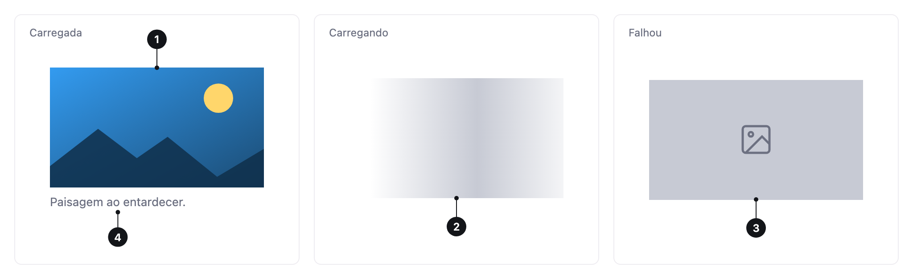

<ComponentEmbed component="Image" variant="default" />

## Best practices

<DosDonts variant="do" title="Content images">
  Photos, covers, illustrations and screenshots.
</DosDonts>

<DosDonts variant="do" title="Loading without jumps">
  Image reserves the space before loading and shows an indicator while it loads.
</DosDonts>

<DosDonts variant="do" title="Loading failure">
  It offers an alternative if the image does not load.
</DosDonts>

<DosDonts variant="dont" title="Icons">
  Use the system icon set.
</DosDonts>

<DosDonts variant="dont" title="Photos of people or small logos">
  Use [Avatar](../avatar/index.mdx).
</DosDonts>

<DosDonts variant="dont" title="Decorative backgrounds">
  Apply them with CSS.
</DosDonts>

## Anatomy

1. **Image**: the main content.
2. **Placeholder**: fills the area before loading, preventing layout jumps.
3. **Fallback**: an alternative color or image when the main one fails.
4. **Caption** (optional): describes the image below it.

## Aspect ratio

Set `aspect-ratio` (such as `16/9`, `4/3` or `1/1`) to reserve the space. This keeps the page content from jumping when the image appears. The `fit` setting (`cover` by default) defines how the image fills the area.

## Shape

With `radius`, the image gets rounded corners, or a full circle for round images.

<ComponentEmbed component="Image" variant="circle" />

## Caption

With `caption`, the image becomes a figure with a caption. Use it when the text adds context, such as source, date or description.

<ComponentEmbed component="Image" variant="caption" />

## Related

- [Avatar](../avatar/index.mdx): photos of people.
- [Card](../card/index.mdx): images inside cards.
- [Grid](../../layout/grid/index.mdx): galleries.
