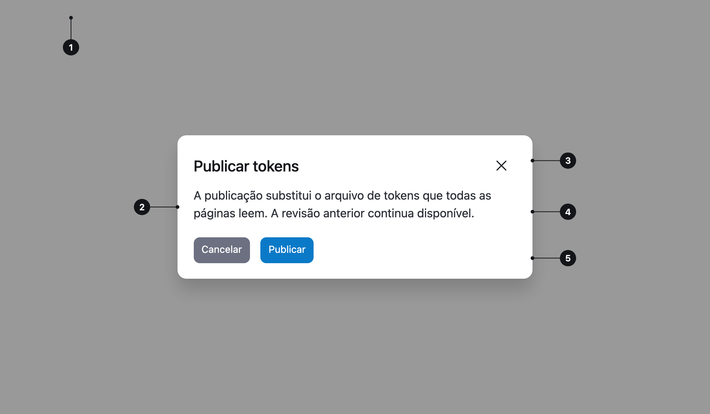

<ComponentEmbed component="Modal" variant="closed" />

## Boas práticas

<DosDonts variant="do" title="Ação importante ou destrutiva">
  A pessoa confirma antes de continuar.
</DosDonts>

<DosDonts variant="do" title="Tarefa curta e focada">
  Renomear um item ou convidar alguém.
</DosDonts>

<DosDonts variant="do" title="Informação que bloqueia o fluxo">
  Algo que a pessoa precisa ler antes de seguir.
</DosDonts>

<DosDonts variant="dont" title="Mensagens que não exigem decisão">
  Use [Alert](../alert/index.mdx) ou [Toast](../toast/index.mdx).
</DosDonts>

<DosDonts variant="dont" title="Conteúdo longo ou fluxos com vários passos">
  Use uma página própria ou um [Drawer](../drawer/index.mdx).
</DosDonts>

<DosDonts variant="dont" title="Consultar a página enquanto trabalha">
  Use um Drawer.
</DosDonts>

<DosDonts variant="dont" title="Dicas e ajuda contextual">
  Use um [Tooltip](../tooltip/index.mdx).
</DosDonts>

## Anatomia

1. **Backdrop**: escurece a página atrás.
2. **Janela**: a superfície centralizada.
3. **Cabeçalho**: título e botão de fechar.
4. **Corpo**: o conteúdo.
5. **Rodapé** (opcional): botões de ação.

## Tamanhos

| Tamanho | Quando usar |
| --- | --- |
| `sm` | Confirmações curtas. |
| `md` (padrão) | A maioria dos casos. |
| `lg` | Conteúdo com mais informação, como formulários pequenos. |

## Comportamento

- Abre no centro da tela, com um backdrop.
- O foco entra na janela, e a página atrás fica inacessível.
- Fecha com o botão de fechar, com `Esc` e com os botões de ação.
- Ao fechar, o foco volta ao elemento que abriu o Modal.

## Sem ações

Se o Modal for só informativo, omita o rodapé. O botão de fechar basta.

<ComponentEmbed component="Modal" variant="open" />

## Relacionados

- [Drawer](../drawer/index.mdx): painel lateral para tarefas mais longas.
- [Alert](../alert/index.mdx), [Toast](../toast/index.mdx): mensagens sem bloqueio.
- [Button](../../actionable/button/index.mdx): ações do rodapé.
