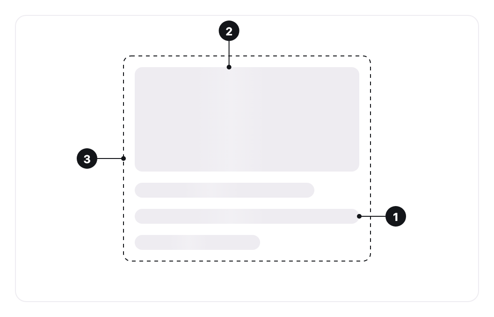

<ComponentEmbed component="Skeleton" variant="card" />

## Best practices

<DosDonts variant="do" title="Content with a known shape">
  A line of text, an avatar, a cover, a list item: the layout of what will appear is already known.
</DosDonts>

<DosDonts variant="do" title="First load of a page or a section">
  A feed, a profile header or a table that fills in after the request.
</DosDonts>

<DosDonts variant="dont" title="No data to show">
  When the request returns nothing, use an [Empty State](../empty-state/index.mdx).
</DosDonts>

<DosDonts variant="dont" title="Errors">
  A failed load needs a message. Use an [Alert](../alert/index.mdx).
</DosDonts>

<DosDonts variant="dont" title="Measurable progress">
  For uploads and imports, where the person wants to know how much is left, use a [Progress Bar](../progress-bar/index.mdx).
</DosDonts>

## Anatomy

1. **Bone**: the shape that stands in for one piece of content. Each one is decorative.
2. **Shimmer**: the light that crosses the bone while the content loads. It stops under `prefers-reduced-motion`.
3. **Loading region**: the container that will receive the real content. It is the one that announces the loading, once.

## Shapes

| Shape | Stands in for | Default size |
| --- | --- | --- |
| **Text** (default) | Paragraphs, headings and metadata. | Height of the context font (`1em`), full width. |
| **Circle** | Avatars and round marks. | 40px, the size of the large avatar. |
| **Rectangle** | Covers, maps, charts and blocks. | Full width, the largest fluid step in height. |

<ComponentEmbed component="Skeleton" variant="circle" />

<ComponentEmbed component="Skeleton" variant="rectangle" />

## Compositions

Combine shapes to anticipate the final layout: a cover and three lines for a card, a circle and two lines for a list item. Shorten the last line of a block with `width` so it reads as text.

<ComponentEmbed component="Skeleton" variant="list" />

## Related

- [Progress Bar](../progress-bar/index.mdx): progress of a task that can be measured.
- [Empty State](../empty-state/index.mdx): when there is nothing to show.
- [Avatar](../avatar/index.mdx) and [Image](../image/index.mdx): what the circle and the rectangle usually stand in for.
