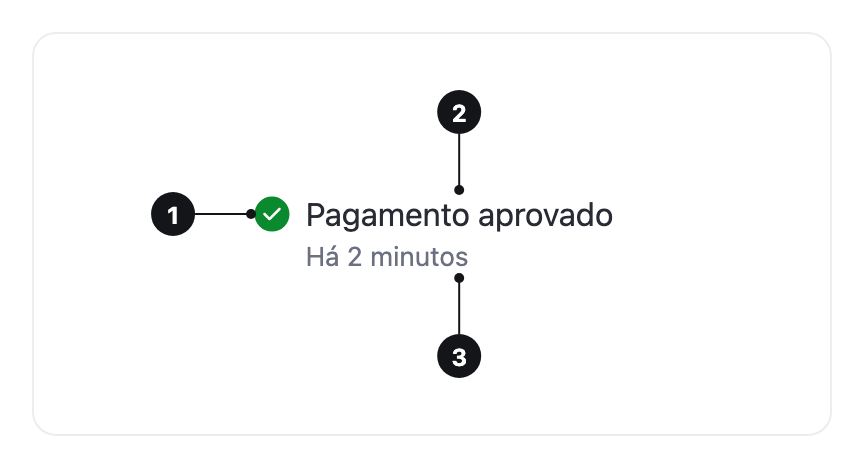

<ComponentEmbed component="Status" variant="default" />

## Best practices

<DosDonts variant="do" title="Result of an operation">
  "Payment approved" or "Sync failed" in a list of transactions or jobs.
</DosDonts>

<DosDonts variant="do" title="Health of a service">
  The state of each service in a monitoring table, checked at a glance.
</DosDonts>

<DosDonts variant="do" title="A person's availability">
  Online, away, busy or offline, next to a name.
</DosDonts>

<DosDonts variant="dont" title="Messages that ask for reading or action">
  Status only names the state. Use an [Alert](../alert/index.mdx).
</DosDonts>

<DosDonts variant="dont" title="Classifying an item">
  For a category or a label, use a [Tag](../tag/index.mdx).
</DosDonts>

<DosDonts variant="dont" title="Clickable actions">
  Status is not interactive. Use [Button](../../actionable/button/index.mdx).
</DosDonts>

## Anatomy

1. **Indicator**: an icon or a dot, in the color of the state. Decorative.
2. **Label**: the text that states the state. Optional, but it is what the screen reader announces.
3. **Description**: a second line, in caption color. Optional.

## Variants

### Feedback

| Variant | Meaning | Example |
| --- | --- | --- |
| **Success** | Something completed or healthy. | "Payment approved", "Operational" |
| **Caution** | Attention or something pending. | "Pending review", "Degraded" |
| **Danger** | A failure or something blocked. | "Sync failed", "Down" |
| **Info** | A neutral fact. | "Scheduled", "In maintenance" |

By default, the feedback statuses show a 20px icon. With `dot`, they show an 8px dot, more discreet, for lists and tables with many rows.

<ComponentEmbed component="Status" variant="dot" />

### Social

`online`, `away`, `busy` and `offline` are a person's presence statuses, the same ones [Avatar](../avatar/index.mdx) draws in its corner. The dot measures 16px and has a shape of its own besides the color: `online` is filled, `away` shows clock hands, `busy` a bar and `offline` an empty center.

<ComponentEmbed component="Status" variant="social" />

## Label and description

`label` is the status text and `description` a second line. The indicator is aligned with the first line of the label, even when it wraps.

<ComponentEmbed component="Status" variant="description" />

## Sizes

`md` (default) and `lg`. The size changes only the label: the description and the indicator keep theirs.

## Pulse

`pulse` makes a ring in the status color grow and fade around the indicator. Use it for a live state: a recording, a call, a service coming back.

<ComponentEmbed component="Status" variant="pulse" />

## Related

- [Tag](../tag/index.mdx): classifies an item with a short label.
- [Alert](../alert/index.mdx): a message with context and, sometimes, an action.
- [Avatar](../avatar/index.mdx): uses the social statuses in its corner.
- [Table](../table/index.mdx): where Status shows the state of each row.
