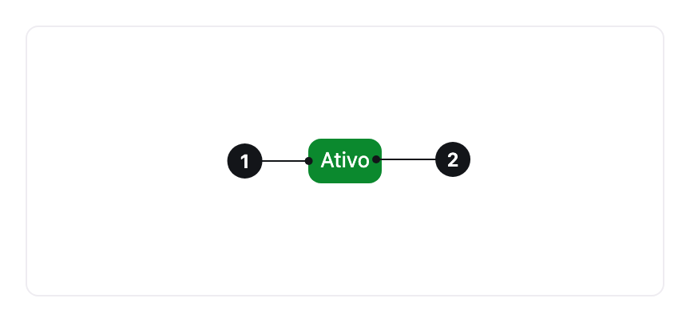

<ComponentEmbed component="Tag" variant="surface" />

## Best practices

<DosDonts variant="do" title="Status">
  The state of an order or the stage of a feature.
</DosDonts>

<DosDonts variant="do" title="Category">
  The type of a piece of content or the label of an item.
</DosDonts>

<DosDonts variant="dont" title="Clickable actions">
  Tag is not a button. Use [Button](../../actionable/button/index.mdx).
</DosDonts>

<DosDonts variant="dont" title="Long messages">
  Use an [Alert](../alert/index.mdx).
</DosDonts>

<DosDonts variant="dont" title="Counters and notifications">
  Use a dedicated numeric indicator.
</DosDonts>

<DosDonts variant="dont" title="Sentences">
  Tag is for one or two words.
</DosDonts>

## Anatomy

1. **Container**: defines the color, the radius and the spacing.
2. **Label**: the short text.

## Styles

| Style | Description | When to use |
| --- | --- | --- |
| **Surface** (default) | Soft background. | Most cases, including tables and lists. |
| **Container** | Emphasis background. | When the tag needs more emphasis. |

<ComponentEmbed component="Tag" variant="container" />

## Variants

The color follows the meaning:

| Variant | Meaning | Example |
| --- | --- | --- |
| **Primary** | Brand emphasis or main category. | "New" |
| **Success** | Something positive or completed. | "Active", "Paid" |
| **Caution** | Attention or something pending. | "Pending", "Expires soon" |
| **Danger** | A problem or something negative. | "Failed", "Declined" |
| **Neutral** | Information with no loaded meaning. | "Draft", "Archived" |

## Sizes and shape

`sm`, `md` (default), `lg` and `xl`. With `circle`, the Tag becomes fully rounded, like a pill.

## Related

- [Table](../table/index.mdx): where Tags indicate status.
- [Avatar](../avatar/index.mdx): presence status.
- [Alert](../alert/index.mdx): messages with more context.
- [Status](../status/index.mdx): the state of a system or a person, with an icon or a dot.
