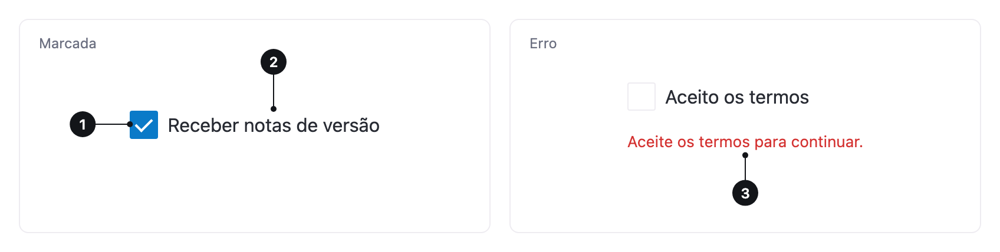

<ComponentEmbed component="Checkbox" variant="unchecked" />

## Boas práticas

<DosDonts variant="do" title="Selecionar vários itens">
  Interesses, permissões ou filtros de uma lista.
</DosDonts>

<DosDonts variant="do" title="Confirmar uma opção ao enviar">
  Um sim ou não que só vale depois de enviar o formulário, como "Li e aceito os termos".
</DosDonts>

<DosDonts variant="dont" title="Escolha de apenas uma opção">
  Use o [Radio Group](../radio-group/index.mdx).
</DosDonts>

<DosDonts variant="dont" title="Efeito imediato ao alternar">
  Para ligar notificações, por exemplo, use o [Switch](../switch/index.mdx).
</DosDonts>

<DosDonts variant="dont" title="Escolher entre muitas opções">
  Com mais de sete opções, use um [Select](../select/index.mdx) ou uma lista com busca.
</DosDonts>

## Anatomia

1. **Caixa**: mostra o estado marcado ou desmarcado.
2. **Label**: descreve a opção. Clicar nela também alterna a caixa.
3. **Mensagem de erro** (opcional): aparece quando a escolha é obrigatória e está faltando.

## Estados

| Estado | Descrição |
| --- | --- |
| **Desmarcado** | A opção não está escolhida. |
| **Marcado** | A opção está escolhida. |
| **Foco** | A caixa tem anel de foco ao navegar por teclado. |
| **Erro** | A escolha é obrigatória e não foi feita. |
| **Desabilitado** | Não pode ser alterado agora. |

<ComponentEmbed component="Checkbox" variant="checked" />

<ComponentEmbed component="Checkbox" variant="error" />

## Tamanhos

`lg` (padrão) e `md`. Use o mesmo tamanho dentro de um grupo.

## Relacionados

- [Radio Group](../radio-group/index.mdx): uma única escolha.
- [Switch](../switch/index.mdx): ligar e desligar com efeito imediato.
- [Select](../select/index.mdx): uma opção de uma lista longa.
