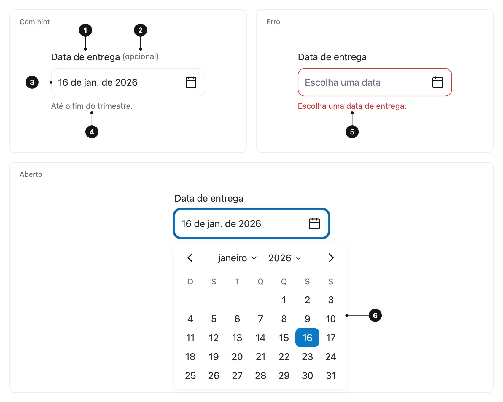

<ComponentEmbed component="DatePicker" variant="default" />

## Boas práticas

<DosDonts variant="do" title="Datas próximas">
  Agendamentos, reservas e prazos, em que ver o calendário ajuda a escolher.
</DosDonts>

<DosDonts variant="do" title="Quando o dia da semana importa">
  "Toda segunda", "evitar o fim de semana": o calendário mostra a semana inteira.
</DosDonts>

<DosDonts variant="do" title="Períodos">
  Uma hospedagem, férias ou o filtro de um relatório, com `range`.
</DosDonts>

<DosDonts variant="do" title="Datas que a pessoa já sabe">
  Data de nascimento ou de emissão de um documento, com `editable`, para digitar em vez de navegar mês a mês.
</DosDonts>

<DosDonts variant="dont" title="Só o mês ou só o ano">
  Use um [Select](../select/index.mdx).
</DosDonts>

<DosDonts variant="dont" title="Datas relativas">
  "Últimos 7 dias", "Este mês": ofereça as opções num [Radio Group](../radio-group/index.mdx) ou num Select.
</DosDonts>

<DosDonts variant="dont" title="Horário">
  O Date Picker escolhe só o dia.
</DosDonts>

## Anatomia

1. **Label**: nomeia o campo. Com `range`, descreve o período: "Estadia", "Período do relatório".
2. **Marcador de opcional** (opcional).
3. **Campo**: mostra a data ou o período escolhido, com o ícone de calendário. Com `editable`, é uma caixa de texto com o botão do calendário ao lado.
4. **Hint**: texto de apoio. Com `editable` e sem hint, mostra o formato esperado.
5. **Mensagem de erro**: substitui o hint.
6. **Calendário**: o mês com os dias, os botões de mês anterior e seguinte e o título, que abre as grades de meses e de anos.

O campo tem a mesma anatomia, os mesmos estados e os mesmos tamanhos do [Input](../input/index.mdx).

## Variantes

### Data única

O padrão. Um clique no campo abre o calendário, e escolher um dia fecha.

### Período

Com `range`, o calendário mostra dois meses lado a lado, então um período que passa de um mês para o outro aparece inteiro. O primeiro clique marca uma ponta e o segundo marca a outra, em qualquer ordem. As duas pontas fazem parte do período. Em telas estreitas, os meses ficam um embaixo do outro.

<ComponentEmbed component="DatePicker" variant="range" />

### Digitável

Com `editable`, a pessoa digita só os números, e a máscara põe os separadores na ordem do idioma: `dd / mm / yyyy` em português, `mm / dd / yyyy` em inglês americano. O calendário continua disponível pelo botão ao lado.

<ComponentEmbed component="DatePicker" variant="editable" />

Com `editable range`, as duas datas ficam no mesmo campo, ou em duas caixas com `range-fields="two"`.

## Estados

| Estado | Descrição |
| --- | --- |
| **Padrão** | Sem data, mostra o placeholder. |
| **Preenchido** | Mostra a data no formato do idioma, com o mês abreviado. |
| **Foco** | Anel de foco no campo. Com `editable`, o botão do calendário tem foco próprio. |
| **Aberto** | O calendário aparece abaixo do campo. |
| **Erro** | Borda de erro e mensagem: data obrigatória, fora do período, indisponível, inválida ou fim antes do início. |
| **Desabilitado** | Não pode ser alterado agora. |

<ComponentEmbed component="DatePicker" variant="error" />

No calendário, **hoje** aparece em negrito, o **dia escolhido** tem preenchimento, dias **fora do período** permitido ficam esmaecidos e dias **indisponíveis** ganham um traço.

## Tamanhos

`lg` (padrão) e `md`, como no [Input](../input/index.mdx).

## Relacionados

- [Input](../input/index.mdx): a mesma anatomia, para texto livre.
- [Select](../select/index.mdx): escolher só o mês ou o ano.
- [Radio Group](../radio-group/index.mdx): períodos relativos, como "Últimos 7 dias".
