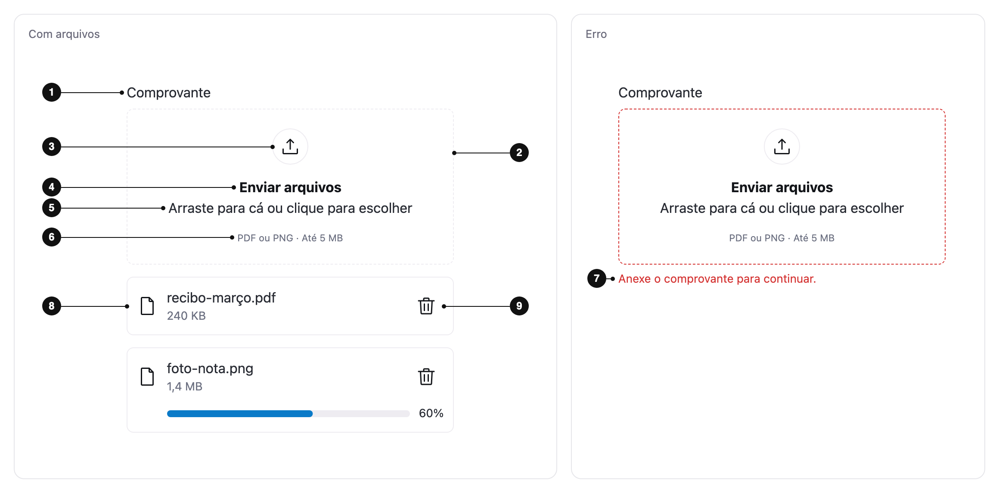

<ComponentEmbed component="FileUpload" variant="default" />

## Best practices

<DosDonts variant="do" title="Attaching your own files">
  A receipt, a résumé, the pictures of a listing.
</DosDonts>

<DosDonts variant="do" title="One or several files">
  The same field covers a single file and a list, with a limit on count, size and type.
</DosDonts>

<DosDonts variant="dont" title="A single file in a short form">
  When there is no list and no drag and drop, a native `<input type="file">` may be enough.
</DosDonts>

<DosDonts variant="dont" title="Choosing among files already in the system">
  Use a list or a [Select](../select/index.mdx), not the device picker.
</DosDonts>

<DosDonts variant="dont" title="Pasted or typed text">
  Use the [Textarea](../textarea/index.mdx).
</DosDonts>

## Anatomy

1. **Label**: names the field, above the zone. Optional.
2. **Zone**: the area that takes a drop and opens the picker on click, touch and keyboard.
3. **Icon**: marks the zone as an upload target.
4. **Zone title**: the call to action, such as "Upload files".
5. **Description**: tells how to add files, such as "Drop files here or click to browse".
6. **Constraints**: accepted formats, maximum size and maximum count.
7. **Error message**: appears below the zone when the field is invalid.
8. **File list**: one item per file, with its name, size, state and actions.
9. **File actions**: Remove on every item, and Retry when sending failed.

## Variations

| Variation | When to use |
| --- | --- |
| **Single file** | One document, such as a contract. A valid new file replaces the current one. |
| **Multiple files** (`multiple`) | Several attachments. Each selection adds to the list. |
| **With limit** (`max-files`) | The product accepts only a set number of files. |
| **Optional** (`optional`) | The file is not needed to submit the form. |

## States

| State | What the person sees |
| --- | --- |
| **Default** | Dashed border, icon, title, description and constraints. |
| **Hover and focus** | Border and focus ring in the primary color, as in the other fields. |
| **Dragging files** | Primary border while files are over the zone. |
| **Error** | Danger border and the error message below the zone. |
| **Limit reached** | The zone is dimmed and stops accepting files. The constraints line says the limit was reached. |
| **Disabled** | The zone and the file actions are blocked. |

<ComponentEmbed component="FileUpload" variant="drag-active" />

<ComponentEmbed component="FileUpload" variant="error" />

### File states

Each file in the list shows where it is in the sending, as reported by the app.

| State | What the person sees |
| --- | --- |
| **Selected** | Name and size. |
| **Uploading** | A progress bar with the percentage, or an indeterminate bar when the app has no progress. |
| **Complete** | Name and size, as for a selected file. The state is read by screen readers. |
| **Failed** | Danger border, icon, message and a **Retry** button. |
| **Rejected** | Danger border and a message that names the file, the problem and how to fix it. The file is not part of the field. |

## Related

- [Textarea](../textarea/index.mdx): typed text instead of files.
- [Select](../select/index.mdx): choosing among existing options.
- [Button](../../actionable/button/index.mdx): the same action pattern on the file actions.
