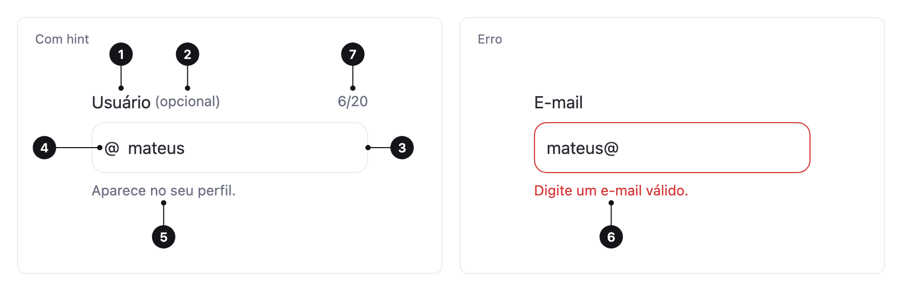

<ComponentEmbed component="Input" variant="default" />

## Boas práticas

<DosDonts variant="do" title="Dados pessoais e de contato">
  Nome, e-mail, telefone e endereço.
</DosDonts>

<DosDonts variant="do" title="Respostas curtas e abertas">
  Busca, senha, quantidade: qualquer resposta de uma linha só.
</DosDonts>

<DosDonts variant="dont" title="Texto longo ou com várias linhas">
  Use o [Textarea](../textarea/index.mdx).
</DosDonts>

<DosDonts variant="dont" title="Escolha entre opções conhecidas">
  Use [Select](../select/index.mdx), [Radio Group](../radio-group/index.mdx) ou [Checkbox](../checkbox/index.mdx).
</DosDonts>

<DosDonts variant="dont" title="Ligar ou desligar algo">
  Use o [Switch](../switch/index.mdx).
</DosDonts>

## Anatomia

1. **Label**: nomeia o campo. Fica sempre visível, acima do campo.
2. **Marcador de opcional** (opcional): "(opcional)" ao lado da label.
3. **Campo**: onde a pessoa digita.
4. **Prefixo e sufixo** (opcionais): texto fixo antes ou depois do valor, como "R$" ou "kg".
5. **Hint**: texto de ajuda abaixo do campo.
6. **Mensagem de erro**: substitui o hint quando o valor é inválido.
7. **Contador** (opcional): caracteres usados, com `maxlength`. Fica acima do campo, à direita.

## Tipos

| Tipo | Quando usar |
| --- | --- |
| `text` | Texto geral. |
| `email`, `tel`, `url` | Formatos específicos. Abrem o teclado adequado no celular. |
| `password` | Senhas, com botão para mostrar e ocultar. |
| `number` | Quantidades, com botões de aumentar e diminuir. |

## Tamanhos

`lg` (padrão) para formulários comuns e `md` para layouts densos. Use o mesmo tamanho para todos os campos de um formulário.

## Estados

| Estado | Quando acontece |
| --- | --- |
| **Padrão** | Campo vazio ou preenchido, em repouso. |
| **Hover** | O ponteiro está sobre o campo. |
| **Foco** | O campo está recebendo digitação. |
| **Erro** | O valor não é válido. Mostra a mensagem de erro. |
| **Desabilitado** | O campo não pode ser editado agora. |

<ComponentEmbed component="Input" variant="hint" />

<ComponentEmbed component="Input" variant="error" />

## Relacionados

- [Textarea](../textarea/index.mdx): texto longo.
- [Select](../select/index.mdx): escolher uma opção de uma lista.
- [Checkbox](../checkbox/index.mdx), [Radio Group](../radio-group/index.mdx) e [Switch](../switch/index.mdx): outros controles de formulário.
