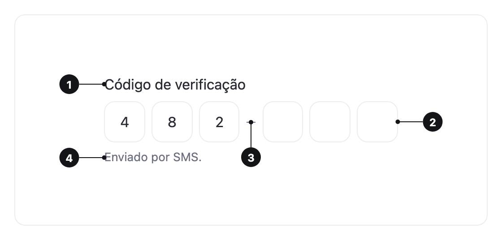

<ComponentEmbed component="OtpInput" variant="default" />

## Best practices

<DosDonts variant="do" title="Verification codes">
  The code sent by SMS or email to confirm a sign-in, a sign-up or a payment.
</DosDonts>

<DosDonts variant="do" title="Short codes with a fixed length">
  A 4-digit PIN or a 6-character code, where each box shows how much is left.
</DosDonts>

<DosDonts variant="dont" title="Passwords">
  The code appears in clear text. For a password, use an [Input](../input/index.mdx) with `type="password"`.
</DosDonts>

<DosDonts variant="dont" title="Values without a fixed length">
  Names, emails and numbers of any size. Use an [Input](../input/index.mdx).
</DosDonts>

## Anatomy

1. **Label**: names the field. Hidden by default, when the page title already explains the code.
2. **Boxes**: one per character.
3. **Separator**: splits the boxes into groups. Optional.
4. **Hint or error message**: below the boxes.

## Behavior

- Typing a character moves focus to the next box.
- `Backspace` in an empty box goes back to the previous one and clears it.
- Pasting a complete code fills every box, whatever box has focus.
- The first box suggests the code received by SMS (`autocomplete="one-time-code"`).
- When all boxes are filled, the component emits `lui-complete` with the code.

## Types

| Type | Accepts | Keyboard |
| --- | --- | --- |
| **Text** (default) | Letters and digits. | The default keyboard. |
| **Number** | Digits only. | The numeric keyboard, on touch devices. |

## Length and separator

`length` sets the number of boxes (6 by default). `separator` splits them into groups, such as 3 + 3, which makes long codes easier to read and copy.

<ComponentEmbed component="OtpInput" variant="separator" />

<ComponentEmbed component="OtpInput" variant="length" />

## States

Default, focus, filled, error and disabled.

<ComponentEmbed component="OtpInput" variant="error" />

## Related

- [Input](../input/index.mdx): text fields of any length, including passwords.
- [Button](../../actionable/button/index.mdx): the action that submits the code.
