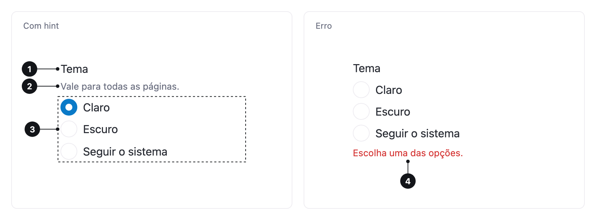

<ComponentEmbed component="RadioGroup" variant="default" />

## Boas práticas

<DosDonts variant="do" title="Uma única opção entre duas a sete">
  Método de pagamento, tamanho, frequência ou plano.
</DosDonts>

<DosDonts variant="do" title="Comparar as opções lado a lado">
  Quando ver todas ao mesmo tempo ajuda a decidir.
</DosDonts>

<DosDonts variant="dont" title="Escolher várias opções">
  Use o [Checkbox](../checkbox/index.mdx).
</DosDonts>

<DosDonts variant="dont" title="Mais de sete opções">
  Use o [Select](../select/index.mdx).
</DosDonts>

<DosDonts variant="dont" title="Ligar ou desligar">
  Use o [Switch](../switch/index.mdx).
</DosDonts>

<DosDonts variant="dont" title="Efeito imediato com só duas opções">
  Para algo como "Ativar notificações", considere um Switch.
</DosDonts>

## Anatomia

1. **Título do grupo**: a pergunta que as opções respondem.
2. **Hint** (opcional): texto de apoio, entre o título e as opções.
3. **Opções** (Radios): as escolhas possíveis.
4. **Mensagem de erro**: aparece abaixo das opções quando falta uma escolha obrigatória.

## Variações

| Variação | Quando usar |
| --- | --- |
| **Padrão** | Escolha simples com título. |
| **Com hint** | A pessoa precisa de uma orientação adicional. |
| **Obrigatório** | A escolha precisa ser feita para continuar. |
| **Desabilitado** | A escolha não está disponível agora. |

Os tamanhos `lg` (padrão) e `md` seguem o [Input](../input/index.mdx).

<ComponentEmbed component="RadioGroup" variant="hint" />

<ComponentEmbed component="RadioGroup" variant="error" />

## Relacionados

- [Radio](../radio/index.mdx): cada opção.
- [Checkbox](../checkbox/index.mdx): várias escolhas.
- [Select](../select/index.mdx): lista longa de opções.
