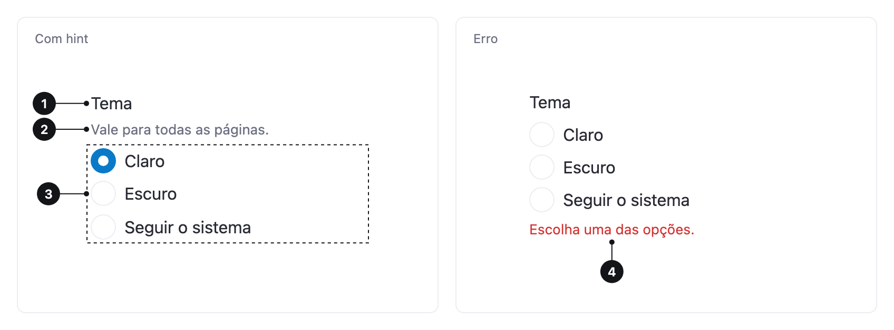

<ComponentEmbed component="RadioGroup" variant="default" />

## Best practices

<DosDonts variant="do" title="A single option out of two to seven">
  Payment method, size, frequency or plan.
</DosDonts>

<DosDonts variant="do" title="Comparing the options side by side">
  When seeing them all at once helps people decide.
</DosDonts>

<DosDonts variant="dont" title="Choosing several options">
  Use the [Checkbox](../checkbox/index.mdx).
</DosDonts>

<DosDonts variant="dont" title="More than seven options">
  Use the [Select](../select/index.mdx).
</DosDonts>

<DosDonts variant="dont" title="Turning on or off">
  Use the [Switch](../switch/index.mdx).
</DosDonts>

<DosDonts variant="dont" title="Immediate effect with only two options">
  For something like "Turn on notifications", consider a Switch.
</DosDonts>

## Anatomy

1. **Group title**: the question the options answer.
2. **Hint** (optional): helper text, between the title and the options.
3. **Options** (Radios): the possible choices.
4. **Error message**: appears below the options when a required choice is missing.

## Variations

| Variation | When to use |
| --- | --- |
| **Default** | Simple choice with a title. |
| **With hint** | The person needs additional guidance. |
| **Required** | The choice must be made to continue. |
| **Disabled** | The choice is not available right now. |

The `lg` (default) and `md` sizes follow the [Input](../input/index.mdx).

<ComponentEmbed component="RadioGroup" variant="hint" />

<ComponentEmbed component="RadioGroup" variant="error" />

## Related

- [Radio](../radio/index.mdx): each option.
- [Checkbox](../checkbox/index.mdx): multiple choices.
- [Select](../select/index.mdx): a long list of options.
