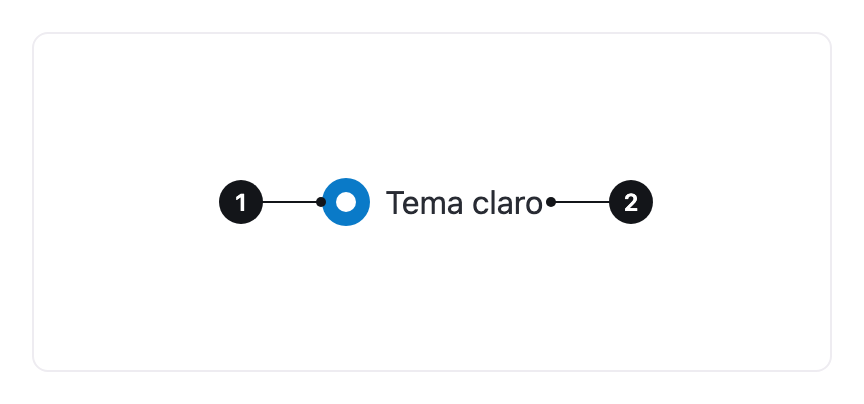

<ComponentEmbed component="Radio" variant="unselected" />

## Boas práticas

<DosDonts variant="do" title="Escolha de exatamente uma opção">
  Entre duas e sete opções, sempre dentro de um [Radio Group](../radio-group/index.mdx).
</DosDonts>

<DosDonts variant="do" title="Todas as opções à vista">
  Quando a pessoa precisa ver as opções ao mesmo tempo para escolher.
</DosDonts>

<Callout variant="info">
  O Radio não vive sozinho. Para montar uma escolha completa, com título, dica e erro, use o [Radio Group](../radio-group/index.mdx), que organiza os Radios.
</Callout>

<DosDonts variant="dont" title="Várias opções ao mesmo tempo">
  Use o [Checkbox](../checkbox/index.mdx).
</DosDonts>

<DosDonts variant="dont" title="Ligar ou desligar">
  Use o [Switch](../switch/index.mdx).
</DosDonts>

<DosDonts variant="dont" title="Mais de sete opções">
  Use um [Select](../select/index.mdx).
</DosDonts>

## Anatomia

1. **Círculo**: mostra se a opção está escolhida.
2. **Label**: descreve a opção. Clicar nela também escolhe o Radio.

## Estados

| Estado | Descrição |
| --- | --- |
| **Não selecionado** | A opção não foi escolhida. |
| **Selecionado** | A opção está escolhida. Só uma por grupo. |
| **Foco** | Anel de foco ao navegar por teclado. |
| **Erro** | O grupo exige uma escolha e ela não foi feita. |
| **Desabilitado** | A opção não está disponível. |

<ComponentEmbed component="Radio" variant="selected" />

## Relacionados

- [Radio Group](../radio-group/index.mdx): o contêiner das opções.
- [Checkbox](../checkbox/index.mdx): várias escolhas.
- [Select](../select/index.mdx): escolha em uma lista longa.
