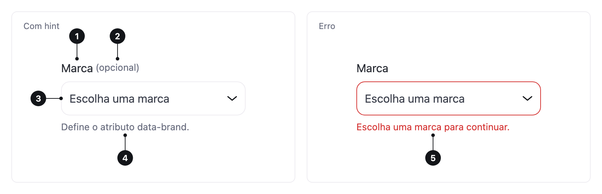

<ComponentEmbed component="Select" variant="default" />

## Best practices

<DosDonts variant="do" title="One option among many">
  With more than seven options, such as country, state, time zone or year.
</DosDonts>

<DosDonts variant="do" title="Little room on the screen">
  When showing every option would take up too much space.
</DosDonts>

<DosDonts variant="do" title="Forms on mobile">
  Since it uses the native picker, it works well on phones, with scrolling and type-to-search.
</DosDonts>

<DosDonts variant="dont" title="Few options (up to seven)">
  Use the [Radio Group](../radio-group/index.mdx), which shows them all at once.
</DosDonts>

<DosDonts variant="dont" title="Multiple selections">
  Use [Checkboxes](../checkbox/index.mdx).
</DosDonts>

<DosDonts variant="dont" title="List with search, tags or rich content">
  The native Select does not do that.
</DosDonts>

<DosDonts variant="dont" title="Actions instead of values">
  Use the [Dropdown Menu](../../actionable/dropdown-menu/index.mdx).
</DosDonts>

## Anatomy

1. **Label**: names the field.
2. **Optional marker** (optional).
3. **Field**: shows the current option or the placeholder, with an arrow.
4. **Hint**: helper text.
5. **Error message**: replaces the hint when a choice is missing.

## States

Default, hover, focus, open, error and disabled. The **placeholder** ("Select an option") is not a valid choice: when the field is required, it must be replaced by a real option.

<ComponentEmbed component="Select" variant="hint" />

<ComponentEmbed component="Select" variant="error" />

## Sizes

`lg` (default) and `md`, as in the [Input](../input/index.mdx).

## Related

- [Radio Group](../radio-group/index.mdx): a few visible options.
- [Input](../input/index.mdx): free-form answer.
- [Dropdown Menu](../../actionable/dropdown-menu/index.mdx): actions instead of values.
