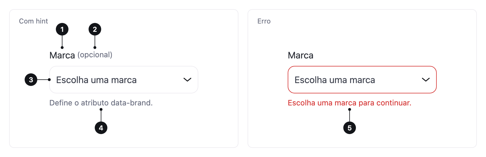

<ComponentEmbed component="Select" variant="default" />

## Boas práticas

<DosDonts variant="do" title="Uma opção entre muitas">
  Com mais de sete opções, como país, estado, fuso horário ou ano.
</DosDonts>

<DosDonts variant="do" title="Pouco espaço na tela">
  Quando mostrar todas as opções ocuparia espaço demais.
</DosDonts>

<DosDonts variant="do" title="Formulários no celular">
  Como usa o seletor nativo, funciona bem em celulares, com rolagem e busca por digitação.
</DosDonts>

<DosDonts variant="dont" title="Poucas opções (até sete)">
  Use o [Radio Group](../radio-group/index.mdx), que mostra todas de uma vez.
</DosDonts>

<DosDonts variant="dont" title="Várias seleções">
  Use [Checkboxes](../checkbox/index.mdx).
</DosDonts>

<DosDonts variant="dont" title="Lista com busca, tags ou conteúdo rico">
  O Select nativo não faz isso.
</DosDonts>

<DosDonts variant="dont" title="Ações em vez de valores">
  Use o [Dropdown Menu](../../actionable/dropdown-menu/index.mdx).
</DosDonts>

## Anatomia

1. **Label**: nomeia o campo.
2. **Marcador de opcional** (opcional).
3. **Campo**: mostra a opção atual ou o placeholder, com uma seta.
4. **Hint**: texto de apoio.
5. **Mensagem de erro**: substitui o hint quando falta uma escolha.

## Estados

Padrão, hover, foco, aberto, erro e desabilitado. O **placeholder** ("Selecione uma opção") não é uma escolha válida: com o campo obrigatório, ele precisa ser trocado por uma opção real.

<ComponentEmbed component="Select" variant="hint" />

<ComponentEmbed component="Select" variant="error" />

## Tamanhos

`lg` (padrão) e `md`, como no [Input](../input/index.mdx).

## Relacionados

- [Radio Group](../radio-group/index.mdx): poucas opções visíveis.
- [Input](../input/index.mdx): resposta livre.
- [Dropdown Menu](../../actionable/dropdown-menu/index.mdx): ações em vez de valores.
