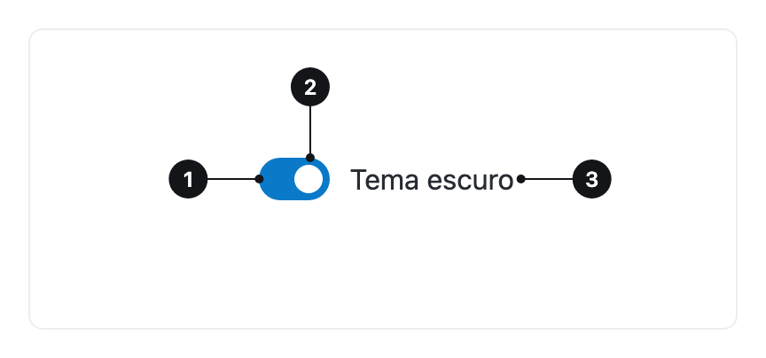

<ComponentEmbed component="Switch" variant="off" />

## Best practices

<DosDonts variant="do" title="Immediate effect">
  The change takes effect right away, without a "Save" button.
</DosDonts>

<DosDonts variant="do" title="On and off preferences">
  Notifications, dark mode or optional features.
</DosDonts>

<DosDonts variant="dont" title="Choices that only apply when a form is submitted">
  Use the [Checkbox](../checkbox/index.mdx).
</DosDonts>

<DosDonts variant="dont" title="Two options with different names">
  To choose between "Monthly" or "Yearly", for example, use the [Radio Group](../radio-group/index.mdx).
</DosDonts>

<DosDonts variant="dont" title="Selecting several items from a list">
  Use Checkboxes.
</DosDonts>

## Anatomy

1. **Track**: the base of the control.
2. **Thumb**: the circle that slides. Its position shows the state.
3. **Label**: describes what the Switch controls.

## States

| State | Description |
| --- | --- |
| **Off** | The feature is turned off. |
| **On** | The feature is active. |
| **Focus** | Focus ring when navigating by keyboard. |
| **Error** | The on state is required and was not turned on. |
| **Disabled** | The control cannot be changed right now. |

<ComponentEmbed component="Switch" variant="on" />

## Sizes

`lg` (default) and `md`.

## Related

- [Checkbox](../checkbox/index.mdx): an option that only applies when the form is submitted.
- [Radio Group](../radio-group/index.mdx): choosing between named options.
