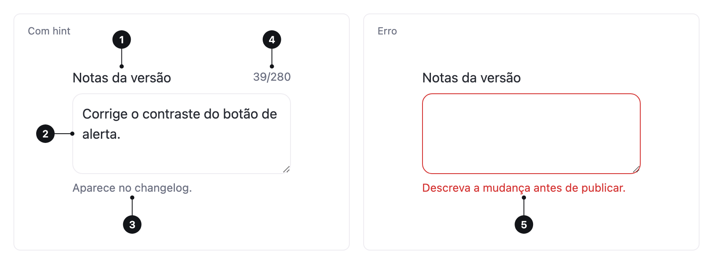

<ComponentEmbed component="Textarea" variant="default" />

## Best practices

<DosDonts variant="do" title="Answers longer than one line">
  Messages, feedback and justifications.
</DosDonts>

<DosDonts variant="do" title="Descriptive texts">
  A bio or an item's description.
</DosDonts>

<DosDonts variant="dont" title="Short answers">
  Use the [Input](../input/index.mdx).
</DosDonts>

<DosDonts variant="dont" title="Formatted text">
  For bold, lists and links, use a rich text editor.
</DosDonts>

<DosDonts variant="dont" title="Choosing among options">
  Use a [Select](../select/index.mdx) or [Radio Group](../radio-group/index.mdx).
</DosDonts>

## Anatomy

1. **Label**: names the field.
2. **Field**: multi-line area, with a resize handle.
3. **Hint**: helper text.
4. **Counter**: characters used, when there is a limit.
5. **Error message**: replaces the hint when the value is invalid.

## Variations

| Variation | When to use |
| --- | --- |
| **Default** | Open answer, with no set limit. |
| **With counter** (`maxlength`) | There is an explicit limit, such as a 160-character bio. |
| **No resizing** (`resize="none"`) | When the layout cannot change, as in fixed message boxes. |

`rows` sets the initial height. Choose a height that suggests the expected length of the answer.

## States

Default, hover, focus, error and disabled, as in the [Input](../input/index.mdx).

<ComponentEmbed component="Textarea" variant="error" />

## Related

- [Input](../input/index.mdx): a single line.
- [Select](../select/index.mdx), [Checkbox](../checkbox/index.mdx): choices.
