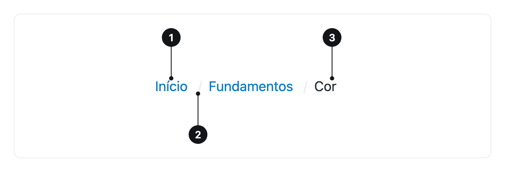

<ComponentEmbed component="Breadcrumb" variant="default" />

## Best practices

<DosDonts variant="do" title="Multi-level hierarchy">
  Documentation, catalogs, admin dashboards and stores with categories.
</DosDonts>

<DosDonts variant="do" title="Show where the person is">
  It answers the question "where am I?" and offers a shortcut back.
</DosDonts>

<DosDonts variant="dont" title="Linear flows">
  In sign-up or checkout, use a step indicator.
</DosDonts>

<DosDonts variant="dont" title="Sites with two levels or fewer">
  A "Back" link is enough.
</DosDonts>

<DosDonts variant="dont" title="As the main navigation">
  The Breadcrumb complements the menu, it does not replace it.
</DosDonts>

## Anatomy

1. **Upper-level items**: links to each ancestor page, from the broadest to the closest.
2. **Separator**: marks the relationship between levels.
3. **Current item**: the page the person is on, with no link and identified as current.

## Behavior

- Ancestor items are links and lead to the corresponding level.
- The last item represents the current page and is **not clickable**.
- The order follows the site hierarchy, not the person's browsing history.

## Related

- [Tabs](../tabs/index.mdx): switch between views of the same page.
- [Link](../link/index.mdx): each item is a link.
- [Pagination](../pagination/index.mdx): move between pages of a list.
