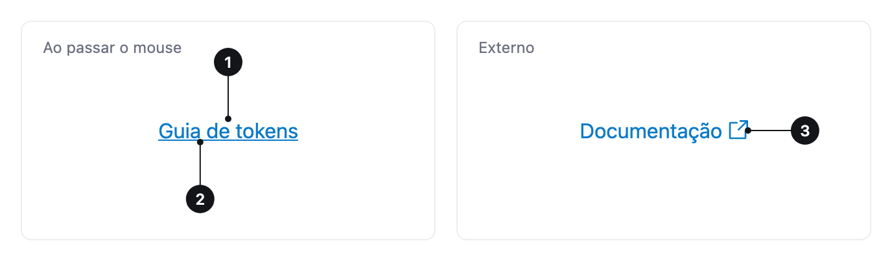

<ComponentEmbed component="Link" variant="default" />

## Best practices

<DosDonts variant="do" title="Navigate">
  To another page or to an anchor on the same page.
</DosDonts>

<DosDonts variant="do" title="External resources and downloads">
  To open an external site or download a file.
</DosDonts>

<DosDonts variant="do" title="Clickable text">
  Inside a paragraph or as a standalone text call to action.
</DosDonts>

<DosDonts variant="dont" title="Run an action">
  To save, send or delete, use a [Button](../../actionable/button/index.mdx).
</DosDonts>

<DosDonts variant="dont" title="Choose between options">
  Use form controls.
</DosDonts>

<DosDonts variant="dont" title="Navigation with many items and an active state">
  Use [Tabs](../tabs/index.mdx) or a menu.
</DosDonts>

## Anatomy

1. **Text**: describes the destination.
2. **Underline**: appears on hover. On keyboard focus, the link gets the focus ring.
3. **External link icon** (optional): indicates the destination leaves the product.

## Types

| Type | When to use |
| --- | --- |
| **Default** | Internal navigation, in the same tab. |
| **External** (`external`) | Destination outside the product. Opens in a new tab and shows an icon. |
| **Download** (`download`) | Clicking downloads a file instead of navigating. |
| **Disabled** (`disabled`) | The destination exists, but is not available right now. |

## Sizes

`lg`, `md` and `sm` follow the [Body](../../typography/body/index.mdx) scale. Without `size`, the link inherits the size of the surrounding text, which is the right behavior inside a paragraph.

## States

Default, hover (underline), focus (visible ring), visited and disabled. The **visited** style is off by default and can be turned on with the `visited` attribute, useful in article lists and search results.

<ComponentEmbed component="Link" variant="disabled" />

## Related

- [Button](../../actionable/button/index.mdx): run actions.
- [Breadcrumb](../breadcrumb/index.mdx): hierarchy links.
- [Body](../../typography/body/index.mdx): the text where the link lives.
