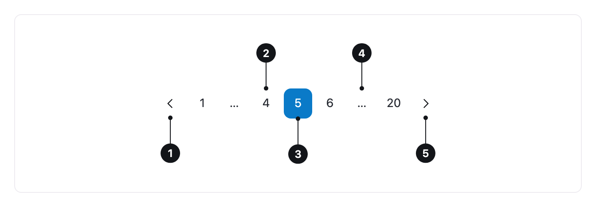

<ComponentEmbed component="Pagination" variant="default" />

## Boas práticas

<DosDonts variant="do" title="Listas e tabelas longas">
  Resultados de busca, tabelas de dados e listagens administrativas.
</DosDonts>

<DosDonts variant="do" title="Voltar a um ponto específico">
  Quando a pessoa precisa localizar ou retornar a uma página da lista.
</DosDonts>

<DosDonts variant="dont" title="Feeds contínuos">
  Em rolagem contínua, como redes sociais, use rolagem infinita ou um botão "Carregar mais".
</DosDonts>

<DosDonts variant="dont" title="Poucos itens">
  Se cabem em uma tela, mostre todos.
</DosDonts>

<DosDonts variant="dont" title="Conteúdo sequencial">
  Para as etapas de um fluxo, use um indicador de passos.
</DosDonts>

## Anatomia

1. **Página anterior**: botão com seta.
2. **Números de página**: cada um leva a uma página.
3. **Página atual**: destacada visualmente.
4. **Reticências**: indicam páginas omitidas.
5. **Próxima página**: botão com seta.

## Comportamento

- A **primeira** e a **última** página ficam sempre visíveis.
- A página atual mantém algumas vizinhas de cada lado, e cada lacuna vira reticências.
- A lista mantém sempre o **mesmo número de itens**, para que os botões não mudem de lugar enquanto a pessoa navega.
- Os botões de anterior e próxima ficam desabilitados na primeira e na última página.
- Em telas estreitas, a quantidade de vizinhas é reduzida.

<ComponentEmbed component="Pagination" variant="few-pages" />

## Relacionados

- [Table](../../content/table/index.mdx): o lugar mais comum para paginar.
- [Select](../../form-and-options/select/index.mdx): controla quantos itens aparecem por página.
- [Button](../../actionable/button/index.mdx): "Carregar mais".
