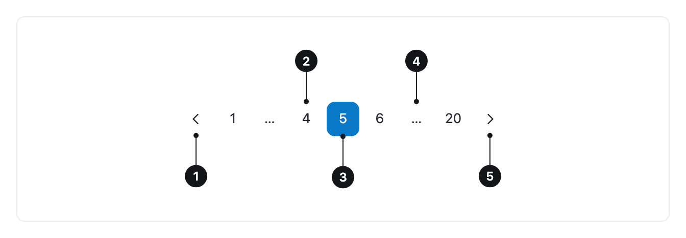

<ComponentEmbed component="Pagination" variant="default" />

## Best practices

<DosDonts variant="do" title="Long lists and tables">
  Search results, data tables and admin listings.
</DosDonts>

<DosDonts variant="do" title="Return to a specific point">
  When the person needs to find or return to a page of the list.
</DosDonts>

<DosDonts variant="dont" title="Continuous feeds">
  For continuous scrolling, like social networks, use infinite scroll or a "Load more" button.
</DosDonts>

<DosDonts variant="dont" title="Few items">
  If they fit on one screen, show them all.
</DosDonts>

<DosDonts variant="dont" title="Sequential content">
  For the steps of a flow, use a step indicator.
</DosDonts>

## Anatomy

1. **Previous page**: button with an arrow.
2. **Page numbers**: each one leads to a page.
3. **Current page**: visually highlighted.
4. **Ellipsis**: indicates omitted pages.
5. **Next page**: button with an arrow.

## Behavior

- The **first** and **last** pages are always visible.
- The current page keeps a few neighbors on each side, and each gap becomes an ellipsis.
- The list always keeps the **same number of items**, so the buttons do not move while the person navigates.
- The previous and next buttons are disabled on the first and last page.
- On narrow screens, the number of neighbors is reduced.

<ComponentEmbed component="Pagination" variant="few-pages" />

## Related

- [Table](../../content/table/index.mdx): the most common place to paginate.
- [Select](../../form-and-options/select/index.mdx): controls how many items appear per page.
- [Button](../../actionable/button/index.mdx): "Load more".
