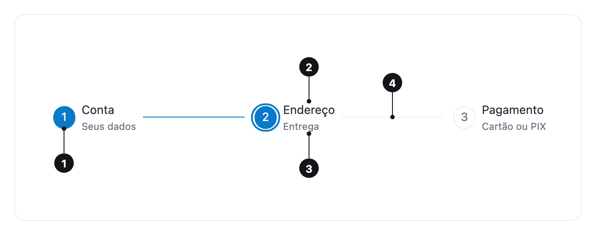

<ComponentEmbed component="Stepper" variant="default" />

## Best practices

<DosDonts variant="do" title="Flows with a known number of steps">
  Three to six steps, where knowing where you are and how much is left helps finish the task.
</DosDonts>

<DosDonts variant="do" title="Long forms split into parts">
  A sign-up split into account, address and payment, each one validated before moving on.
</DosDonts>

<DosDonts variant="dont" title="Independent sections without order">
  To switch between views of the same content, use [Tabs](../tabs/index.mdx).
</DosDonts>

<DosDonts variant="dont" title="Paged content">
  To move through pages of a list, use [Pagination](../pagination/index.mdx).
</DosDonts>

<DosDonts variant="dont" title="Progress of a single task">
  For an upload or an import, use a [Progress Bar](../../content/progress-bar/index.mdx).
</DosDonts>

## Anatomy

1. **Indicator**: a circle with the step number. Its color shows whether the step is completed, current or upcoming.
2. **Label**: the name of the step. Optional.
3. **Description**: supporting text below the label. Optional.
4. **Connector**: the line between two steps, filled up to the current one.

## States

| State | Description |
| --- | --- |
| **Completed** | Steps before the current one, with the connector filled. |
| **Current** | The step the person is on. Highlighted, with `aria-current="step"`. |
| **Upcoming** | Steps after the current one. |
| **Loading** | The number becomes a progress indicator while the step is saved or validated. |
| **Disabled** | A step that cannot be reached. |

<ComponentEmbed component="Stepper" variant="loading" />

## Orientation

| Orientation | When to use |
| --- | --- |
| **Horizontal** (default) | Above the content of the flow, with few, short labels. |
| **Vertical** | Beside the content, or with long labels and descriptions. |

<ComponentEmbed component="Stepper" variant="vertical" />

A horizontal stepper that does not fit its container is shown vertically instead of scrolling sideways, and goes back to horizontal when there is room.

## Label placement

With `label-placement="bottom"`, the label and the description are centered below the number. It only applies to the horizontal orientation.

<ComponentEmbed component="Stepper" variant="labels-bottom" />

## Numbers only

Without labels, each step shows only the indicator. Use it when space is short and the content of the page already names the step.

<ComponentEmbed component="Stepper" variant="numbers" />

## Behavior

- Clicking a step goes to it. The application can cancel the change, for example while a form is invalid.
- With `linear`, the person can only go back to completed steps: the ones ahead do not respond to clicks, but keep their normal color.
- Every change of step is announced to screen readers with the position and the name of the new step.

## Related

- [Tabs](../tabs/index.mdx): sections without order.
- [Pagination](../pagination/index.mdx): pages of a list.
- [Progress Bar](../../content/progress-bar/index.mdx): progress of a single task.
