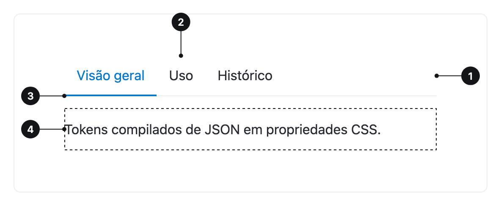

<ComponentEmbed component="Tabs" variant="line" />

## Boas práticas

<DosDonts variant="do" title="Um painel por vez">
  Conteúdo relacionado, na mesma página, que a pessoa vê uma parte de cada vez.
</DosDonts>

<DosDonts variant="do" title="Visões de um mesmo objeto">
  Configurações de um perfil ou seções de uma documentação.
</DosDonts>

<DosDonts variant="dont" title="Navegar entre páginas diferentes">
  Use links, menus ou [Breadcrumb](../breadcrumb/index.mdx).
</DosDonts>

<DosDonts variant="dont" title="Etapas sequenciais">
  Use um indicador de passos.
</DosDonts>

<DosDonts variant="dont" title="Conteúdo que a pessoa precisa comparar lado a lado">
  Mostre tudo na página, ou use uma [Table](../../content/table/index.mdx).
</DosDonts>

<DosDonts variant="dont" title="Mais de sete abas">
  Reveja a organização.
</DosDonts>

## Anatomia

1. **Lista de abas**: o conjunto de rótulos.
2. **Aba**: um rótulo clicável. A ativa se destaca.
3. **Indicador**: marca a aba ativa (linha ou segmento).
4. **Painel**: o conteúdo da aba ativa.

## Estilos

| Estilo | Descrição | Quando usar |
| --- | --- | --- |
| **Line** | Linha abaixo da aba ativa. | Padrão para páginas e seções de conteúdo. |
| **Card** | Abas em um segmento fechado. | Alternar visões dentro de um cartão ou componente menor. |

Com `expand`, as abas ocupam toda a largura do contêiner, bom para telas pequenas.

<ComponentEmbed component="Tabs" variant="expand" />

## Estados

Cada aba pode estar inativa, ativa, em hover, em foco ou desabilitada. Apenas **uma** aba fica ativa por vez, e uma aba sempre vem selecionada.

## Relacionados

- [Accordion](../../content/accordion/index.mdx): seções que expandem e permitem vários abertos.
- [Breadcrumb](../breadcrumb/index.mdx): hierarquia entre páginas.
- [Link](../link/index.mdx): navegação entre páginas.
